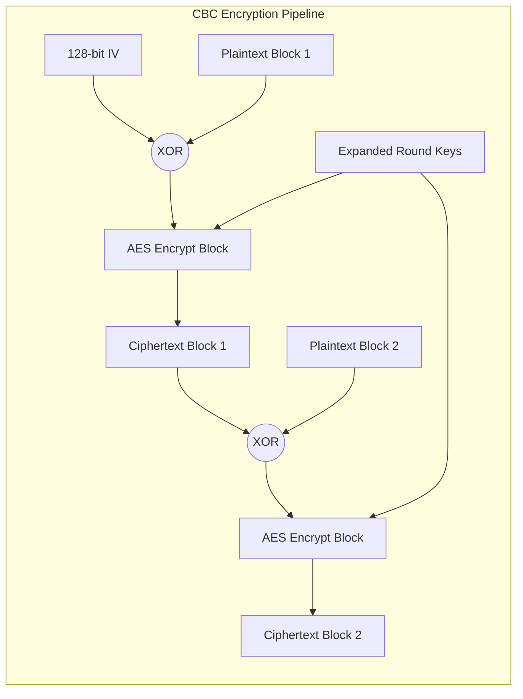

# AES Cryptographic Engine in C (AES-128 / AES-192 / AES-256)


A standalone, zero-dependency C99 implementation of the **Advanced Encryption Standard (AES)** supporting **128-bit, 192-bit, and 256-bit** cipher keys across **Electronic Codebook (ECB)** and **Cipher Block Chaining (CBC)** modes of operation. Verified against official **NIST FIPS PUB 197** and **NIST SP 800-38A** cryptographic test vectors.

---

## Academic Context

> This project was originally developed during the **Information Security and Data Protection (*Informationssicherheit und Datenschutz*)** course at **HTW Dresden**. It has since been refactored into a standalone cryptographic engine aligning with Clean Code principles, strict C type safety, and automated build systems.

---

## Mathematical & Algorithmic Foundation

AES (Rijndael) is a substitution-permutation network (SPN) that operates on a 128-bit (16-byte) data block organized as a column-major state matrix over the finite Galois Field $GF(2^8)$:

$$
\mathbf{S} \in GF(2^8)^{4 \times 4}, \quad \mathbf{S} = \begin{bmatrix} s_{0,0} & s_{0,1} & s_{0,2} & s_{0,3} \\ s_{1,0} & s_{1,1} & s_{1,2} & s_{1,3} \\ s_{2,0} & s_{2,1} & s_{2,2} & s_{2,3} \\ s_{3,0} & s_{3,1} & s_{3,2} & s_{3,3} \end{bmatrix}, \quad s_{r,c} = \text{block}[r + 4c]
$$

### 1. Finite Field $GF(2^8)$ Arithmetic & Polynomial Reduction

Every byte $b = (b_7 b_6 b_5 b_4 b_3 b_2 b_1 b_0)_2$ represents a polynomial in $GF(2)[x]$ of degree at most 7:

$$
b(x) = \sum_{i=0}^{7} b_i x^i
$$

Addition in $GF(2^8)$ corresponds to bitwise XOR ($\oplus$). Multiplication ($\otimes$) is defined modulo the degree-8 irreducible Rijndael polynomial:

$$
m(x) = x^8 + x^4 + x^3 + x + 1 \equiv \text{0x11B}
$$

Multiplication by the monomial $x$ ($\text{0x02}$), implemented in `multiply_2()`, is computed via a 1-bit left shift followed by a conditional modular reduction with `0x1B` when the most significant bit ($b_7$) overflows:

$$
\text{xtime}(b) = x \otimes b \pmod{m(x)} = \begin{cases} (b \ll 1) & \text{if } b_7 = 0 \\ (b \ll 1) \oplus \text{0x1B} & \text{if } b_7 = 1 \end{cases}
$$

Higher-order field multiplications required for `MixColumns` and `InvMixColumns` are derived through repeated applications of $\text{xtime}$ and distributivity over $\oplus$:

$$
\begin{aligned}
\text{0x03} \otimes b &= \text{xtime}(b) \oplus b \\
\text{0x09} \otimes b &= \text{xtime}^3(b) \oplus b \\
\text{0x0b} \otimes b &= \text{xtime}^3(b) \oplus \text{xtime}(b) \oplus b \\
\text{0x0d} \otimes b &= \text{xtime}^3(b) \oplus \text{xtime}^2(b) \oplus b \\
\text{0x0e} \otimes b &= \text{xtime}^3(b) \oplus \text{xtime}^2(b) \oplus \text{xtime}(b)
\end{aligned}
$$

### 2. Non-Linear Substitution Layer (`SubBytes` & `InvSubBytes`)

The `sub_bytes()` transformation provides confusion by applying the Rijndael S-Box independently to each element $s_{r,c}$. The S-Box maps a byte $b \in GF(2^8)$ to its multiplicative inverse $b^{-1}$ (with $\text{0x00} \mapsto \text{0x00}$), followed by an invertible affine transformation over $GF(2)$:

$$
\mathbf{b}^{\prime} = \mathbf{A}\mathbf{b}^{-1} \oplus \mathbf{c}, \quad \mathbf{c} = \text{0x63}
$$

### 3. Linear Diffusion Layer (`ShiftRows` & `MixColumns`)

* **`shift_rows()`:** Introduces inter-column dispersion by cyclically shifting row $r$ to the left by $r$ bytes:

$$
\hat{s}_{r,c} = s_{r, (c + r) \bmod 4}, \quad r \in \{0, 1, 2, 3\}
$$

* **`mix_columns()` & `inv_mix_columns()`:** Treats each column $\mathbf{s}_c$ as a four-term polynomial over $GF(2^8)$ and multiplies it modulo $x^4 + 1$ by a fixed circulant **Maximum Distance Separable (MDS)** matrix:

$$
\underbrace{\begin{bmatrix} \hat{s}_{0,c} \\ \hat{s}_{1,c} \\ \hat{s}_{2,c} \\ \hat{s}_{3,c} \end{bmatrix} = \begin{bmatrix} 02 & 03 & 01 & 01 \\ 01 & 02 & 03 & 01 \\ 01 & 01 & 02 & 03 \\ 03 & 01 & 01 & 02 \end{bmatrix} \begin{bmatrix} s_{0,c} \\ s_{1,c} \\ s_{2,c} \\ s_{3,c} \end{bmatrix}}_{\text{Forward MixColumns}}, \qquad \underbrace{\begin{bmatrix} s_{0,c} \\ s_{1,c} \\ s_{2,c} \\ s_{3,c} \end{bmatrix} = \begin{bmatrix} 0\text{e} & 0\text{b} & 0\text{d} & 09 \\ 09 & 0\text{e} & 0\text{b} & 0\text{d} \\ 0\text{d} & 09 & 0\text{e} & 0\text{b} \\ 0\text{b} & 0\text{d} & 09 & 0\text{e} \end{bmatrix} \begin{bmatrix} \hat{s}_{0,c} \\ \hat{s}_{1,c} \\ \hat{s}_{2,c} \\ \hat{s}_{3,c} \end{bmatrix}}_{\text{Inverse MixColumns}}
$$

> **Algorithmic Implementation Note (Circulant Vector Rotation):** Rather than hardcoding scalar element-by-element equations, `mix_columns()` and `inv_mix_columns()` precompute the full-state scalar multiples ($2\mathbf{S}, 3\mathbf{S}$ for encryption; $9\mathbf{S}, 11\mathbf{S}, 13\mathbf{S}, 14\mathbf{S}$ for decryption) and exploit the circulant structure of the MDS matrix by cyclically right-shifting the 4-element polynomial coefficient vector (`{2, 3, 1, 1}` or `{14, 11, 13, 9}`) via `shift_one_right()` across each row evaluation.

---

## Block Cipher Modes of Operation

| Feature / Property | Electronic Codebook (ECB) | Cipher Block Chaining (CBC) |
| --- | --- | --- |
| **Encryption Rule** | $C_i = E_K(P_i)$ | $C_i = E_K(P_i \oplus C_{i-1}), \quad C_0 = \text{IV}$ |
| **Decryption Rule** | $P_i = D_K(C_i)$ | $P_i = D_K(C_i) \oplus C_{i-1}, \quad C_0 = \text{IV}$ |
| **Initialization Vector (IV)** | Not used | 128-bit unpredictable IV required |
| **Pattern Concealment** | No (identical blocks yield identical ciphertexts) | Yes (probabilistic via ciphertext chaining) |
| **Error Propagation** | Isolated to the corrupted 16-byte block | Affects current block and bit-flips next block |



---

## System Architecture

```text
aes-crypto-engine-c/
├── include/
│   └── aes.h          # Public API, NIST constants, and Doxygen specifications
├── src/
│   ├── aes.c          # Core GF(2^8) arithmetic, key schedule, and ECB/CBC engines
│   └── main.c         # CLI demonstration of AES-256 CBC encryption/decryption
├── tests/
│   └── test_aes.c     # Automated NIST FIPS-197 & SP 800-38A verification suite
├── .gitignore         # Ignores build artifacts, binaries, and IDE configurations
├── LICENSE            # MIT Open-Source License
├── Makefile           # Strict C99 build automation (-Wall -Wextra -Werror -pedantic)
└── README.md          # Project documentation and mathematical specification

```

| Module / File | Responsibility |
| --- | --- |
| `include/aes.h` | Defines standard-compliant `uint8_t` interfaces, key/round macros (`AES_KEY_SIZE_128/192/256`), and full Doxygen documentation. |
| `src/aes.c` | Implements forward/inverse S-Boxes, `key_expansion` with `rc()` in $GF(2^8)$, state transformations (`sub_bytes`, `shift_rows`, `mix_columns`, `add_round_key`), and `ecb_*` / `cbc_*` modes. |
| `tests/test_aes.c` | Validates single-block AES-128/192/256 routines against **NIST FIPS-197 Appendix C** and multi-block ECB/CBC modes against **NIST SP 800-38A Appendix F**. |
| `src/main.c` | Demonstrates in-place AES-256 CBC encryption and decryption of a zero-padded ASCII payload with hexadecimal state inspection. |
| `Makefile` | Automates compilation and test execution using strict C99 flags (`-Wall -Wextra -Werror -pedantic -std=c99 -O2`). |

---

## Build & Usage

### 1. Run the Official NIST Verification Suite

Compile the engine and execute all 10 NIST FIPS-197 and SP 800-38A test vectors:

```bash
make test

```

**Expected Output:**

```text
============================================================
   AES Cryptographic Engine - NIST Verification Test Suite  
============================================================
[PASS] NIST FIPS-197 C.1: AES-128 Block Encrypt
[PASS] NIST FIPS-197 C.1: AES-128 Block Decrypt
[PASS] NIST FIPS-197 C.2: AES-192 Block Encrypt
[PASS] NIST FIPS-197 C.2: AES-192 Block Decrypt
[PASS] NIST FIPS-197 C.3: AES-256 Block Encrypt
[PASS] NIST FIPS-197 C.3: AES-256 Block Decrypt
[PASS] NIST SP 800-38A F.1.1: AES-128 ECB Encrypt (2 Blocks)
[PASS] NIST SP 800-38A F.1.2: AES-128 ECB Decrypt (2 Blocks)
[PASS] NIST SP 800-38A F.2.1: AES-128 CBC Encrypt (2 Blocks)
[PASS] NIST SP 800-38A F.2.2: AES-128 CBC Decrypt (2 Blocks)

Test Summary: 10 / 10 passed.
```

### 2. Run the CLI Demonstration

Build and run the AES-256 CBC demonstration binary:

```bash
make run

```

**Expected Output:**

```text
============================================================
        AES-256 CBC Mode Encryption & Decryption Demo       
============================================================
Original ASCII    : AES Crypto Engine by OST!
Plaintext (Hex)   : 41 45 53 20 43 72 79 70 74 6f 20 45 6e 67 69 6e 65 20 62 79 20 4f 53 54 21 00 00 00 00 00 00 00 
IV (128-bit)      : 00 01 02 03 04 05 06 07 08 09 0a 0b 0c 0d 0e 0f 
Ciphertext (CBC)  : 65 f5 d0 77 1a 2a 17 e9 4b 3d c5 96 ae 39 d2 e9 83 d9 72 79 94 84 27 bb e1 30 e9 a7 ec 6f dd 92 
Decrypted (Hex)   : 41 45 53 20 43 72 79 70 74 6f 20 45 6e 67 69 6e 65 20 62 79 20 4f 53 54 21 00 00 00 00 00 00 00 
Recovered ASCII   : AES Crypto Engine by OST!
============================================================

```

### 3. Clean Build Artifacts

```bash
make clean

```

### 4. Library Integration Example

```c
#include "aes.h"

void example_encrypt(void) {
    uint8_t payload[32] = { /* 16-byte aligned data */ };
    const uint8_t key_256[32] = { /* 32-byte secret key */ };
    const uint8_t iv[16]      = { /* 16-byte initialization vector */ };

    /* Encrypt in-place using AES-256 in CBC mode */
    cbc_encrypt(payload, key_256, AES_KEY_SIZE_256, iv, sizeof(payload));

    /* Decrypt in-place using AES-256 in CBC mode */
    cbc_decrypt(payload, key_256, AES_KEY_SIZE_256, iv, sizeof(payload));
}
```

---

## License

Distributed under the **MIT License**. See [LICENSE](LICENSE) for full details.

